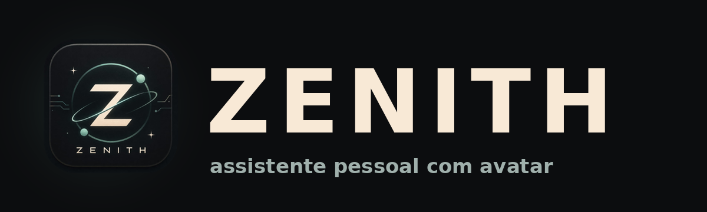

<p align="center"></p>

<p align="center"><b>Um assistente pessoal com avatar, que roda no seu computador e só age com a sua aprovação.</b></p>

> **Estado: Zenith 1.0 Oficial.** Funciona no dia a dia do autor, mas ainda tem arestas. Veja "O que ainda não existe" abaixo.
> Onde está cada documento: `docs/INDICE_DOS_DOCUMENTOS.md`. Como testar tudo: `docs/TESTAR_TUDO.md`.

## O que o Zenith faz

- **Conversa** com a IA que você escolher (Gemini, OpenAI, Claude, Groq e outras), por voz ou texto, com um avatar 3D em formato VRM.
- **Programa com você**: escreve e roda programas, mostra o código antes e conta o que deu certo ou errado.
- **Cria e edita**: imagens (por serviços de IA e por busca), vídeos (cortar, juntar, legendar, narrar) e documentos.
- **Organiza o computador**: arruma pastas, lê documentos e planilhas que você anexa.
- **Enxerga quando você deixa**: tela e câmera, uma foto ou observação ao vivo, sempre com um aviso visível e botão de parar.
- **Aprende como você trabalha**: guarda o que você pede que ele lembre, e adapta o jeito de ensinar e programar.

## As regras que não mudam

1. **Nada roda sem a sua aprovação.** Código, comandos, abrir programas, ver a tela: tudo aparece numa janela para você aprovar.
2. **Existe uma lista de coisas que ele nunca faz**, nem com aprovação (apagar o disco, desligar o PC, mexer em antivírus e firewall).
3. **Suas chaves, conversas e memória ficam só no seu computador.** Não há telemetria.
4. **Sem pegadinha**: o código está aqui para você ler.

## Instalar (Windows 10/11, 64 bits)

1. Baixe pelo site (pasta `site/`, publicado no Vercel) ou direto em [Releases](https://github.com/AndersonScript/Projeto-Zenith/releases/latest).
   O arquivo do programa é o `Zenith_app_1.0.zip`; o `ZenithLauncher.exe` baixa e instala o Python e as bibliotecas para você.
2. Confira o **SHA-256** que aparece na página (no Windows: `certutil -hashfile Zenith_app_1.0.zip SHA256`).
3. Abra o instalador. Ele mostra **onde vai instalar** e **onde guardar suas criações**. Não precisa ser administrador.
4. Na primeira vez, o Zenith pede o seu nome e uma chave de IA. Há opções gratuitas, veja `COMO_USAR.md`.

> O instalador ainda não tem assinatura digital, então o Windows pode mostrar "Windows protegeu seu PC". Por isso o SHA-256.

## O que ainda não existe

Microfone com texto aparecendo enquanto você fala no estilo do Word, biblioteca de cadernos e documentos, janela com moldura própria,
aplicativo Android, versão para ESP32 completa e CLP. Geração de vídeo por IA: hoje o Zenith **edita** vídeo, não o **gera** do zero.
A qualidade das imagens depende do serviço de IA que você configurar.

## Para quem quer mexer no código

O projeto tem duas partes: o **Cérebro** (`brain/`, Python) e o **Corpo** (`body/zenith/`, Godot 4.7).

```
python -m unittest discover -s tests -t .      # os testes não precisam de Godot, internet nem chaves
python zenith_launcher.py                        # roda direto do código (use um venv com Python 3.12 ou 3.13)
python build_exe.py --edicao publico             # gera dist/Zenith  (precisa do Godot exportado; veja docs/PUBLICAR.md)
python tools/preparar_publico.py                 # monta a pasta limpa do GitHub e confere chaves/dados pessoais
```

Avatares: este repositório **não traz** modelo `.vrm`. Coloque o seu em `body/zenith/addons/avatars/` (veja o `LEIA-ME.md` de lá).
Contribuições: leia `CONTRIBUTING.md`. Falha de segurança: `SECURITY.md`.

## Licença

Código sob licença MIT (`LICENSE`). Godot, o addon VRM, bibliotecas Python e fontes mantêm as próprias licenças
(`LICENSES/TERCEIROS.md`). Os modelos de IA e os serviços que você conectar têm os termos deles.
